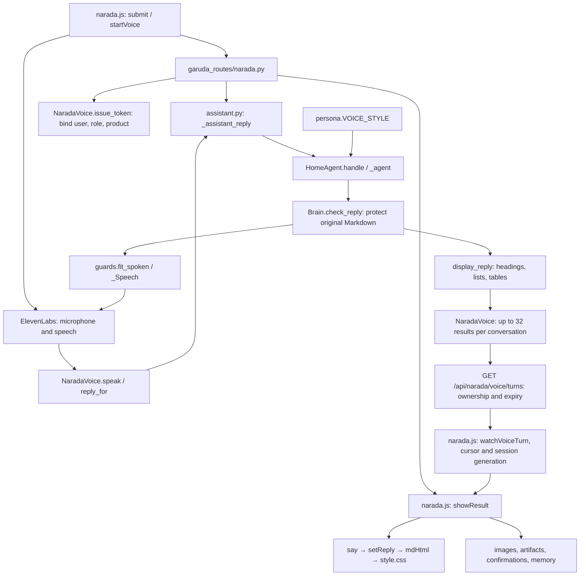
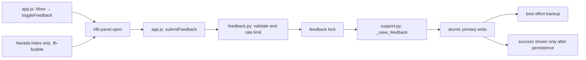

# Narada chat and feedback review

Reviewed 2026-10-15. This graph covers the web chat, voice bridge, reply formatting,
mobile feedback, and their immediate backend dependencies. It is a targeted
review map, not a claim that every feature in the repository has been audited.

## Request and reply graph

## Search index

Paths are relative to the repository root. Search the named symbols with `rg -n`.

| Area | File and entry points | Review boundary |
| --- | --- | --- |
| Chat and voice UI | [narada.js](../../basic_pipelines/garuda_web/narada.js): `startVoice`, `stopVoice`, `watchVoiceTurn`, `showResult`, `ask`, `mdHtml` | Session cancellation, original replies, streaming completion, rendering |
| Navigation and API client | [app.js](../../basic_pipelines/garuda_web/app.js): `_buildMoreSheet`, `toggleFeedback`, `submitFeedback`, `api` | Mobile panel opening and HTTP errors |
| Layout | [style.css](../../basic_pipelines/garuda_web/style.css): `.fb-bubble`, `.fb-panel`, `.nx-msg.md` | Mobile visibility and table containment |
| API | [narada.py](../../basic_pipelines/garuda_routes/narada.py): `chat_stream`, `narada_voice_turns` | Authentication, product scope, sequence cursor |
| Voice bridge | [narada_voice.py](../../basic_pipelines/garuda_auto/narada_voice.py): `issue_token`, `turns_for`, `reply_for`, `speak` | Ownership, TTL, bounded retention, speech/display separation |
| Wiring | [Garuda_web.py](../../basic_pipelines/Garuda_web.py): `NARADA_VOICE` | Injects `_assistant_reply(..., voice=True)` |
| Agent | [agent.py](../../basic_pipelines/garuda_auto/agent.py): `_agent`, `_Speech` | Checked Markdown survives audio conversion |
| Speech policy | [persona.py](../../basic_pipelines/narada_brain/persona.py): `VOICE_STYLE`; [guards.py](../../basic_pipelines/narada_brain/guards.py): `fit_spoken` | Structured display and spoken table content |
| Feedback API | [feedback.py](../../basic_pipelines/garuda_routes/feedback.py): `submit_feedback` | Invalid or failed submissions do not exhaust the submission allowance |
| Feedback storage | [support.py](../../basic_pipelines/garuda_services/support.py): `_save_feedback` | Primary failure is reported; backup failure does not duplicate saved submissions |
| Route inventory | [capabilities.py](../../basic_pipelines/garuda_auto/capabilities.py): `PLUMBING`; [routes.json](../../tests/contract/routes.json) | Display endpoint is UI plumbing, not a model tool |

A temporary expanded index at `/tmp/garuda-review/index.json` contains the 18
reviewed file nodes, 21 dependency edges, and 486 function locations used during
this review. Locations reflect the working tree at index generation time.

## Findings and regression coverage

| Finding | Correction | Regression coverage |
| --- | --- | --- |
| Voice formatting lost through the speech transcript | Preserve checked `display_reply`; fetch it for the bound conversation and use the typed reply renderer | `test_voice_keeps_checked_markdown_for_display`, `test_original_display_reply_and_cards_survive_speech_conversion`, browser voice/typed equivalence |
| Feedback hidden on Narada even when opened from More | Hide the floating trigger only | Mobile dashboard/Narada open, submit, persisted message, close |
| Late voice callbacks reopen a cancelled session | Session generation checks; close late connections; cancel polling | Browser cancelled voice start |
| Typed messages echoed twice during a voice call | Match the pending typed echo | Browser voice/typed equivalence |
| Voice polling could not recognize HTTP failures | Preserve HTTP status in the API client | Browser voice binding expiry |
| Partial streams treated as complete, network errors could replay actions | Require the done event; do not retry ambiguous network failures | Browser interrupted stream and aborted request |
| Failed feedback writes reported success | Propagate primary write errors as 503; allow retries | Feedback API write failure, recovery, backup failure, invalid input tests |
| Voice error claimed nothing changed without rollback evidence | Ask the user to check current state | Voice bridge failure test |

Tests simulate model answers and microphone transport. They do not establish
live microphone recognition quality or ElevenLabs audio playback on a phone.

## Verification

- Broad backend sweep: 1,288 passed, two skipped, two slow tests deselected.
  Its one failure identified the missing route inventory entry; after adding it,
  all 11 capability inventory and route contract checks passed.
- Focused backend/browser suite: 123 passed. Two browser assertions initially
  read visible text from the collapsed chat; changed those assertions to read
  stored text content and reran both successfully. All 125 focused cases are
  now verified, including 15 desktop/mobile browser cases.
- Both JavaScript files pass `node --check`; `git diff --check` is clean.
- Inspected the mobile Chromium screenshot: headings, numbering, table columns,
  bullets, and wrapping render correctly at 390 × 844.
